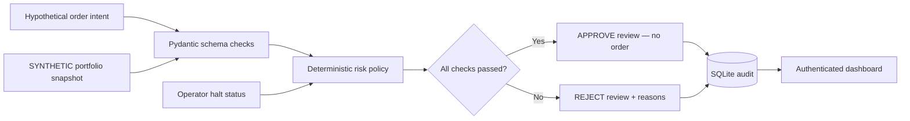

<div align="center">

# RiskGuard Pro
### Explainable Risk Decisions for Algorithmic Trading Infrastructure

**Before an automated strategy trades, make its risk visible.**

[](#quick-start)
[](#architecture)
[](#the-challenge)
[](#verification)
[](LICENSE)

**[Source](src/riskguard) · [Risk engine](src/riskguard/engine.py) · [Example decision](docs/EXAMPLE_RISK_DECISION.json) · [Test suite](tests) · [Case study](docs/CASE_STUDY.md) · [Client brief](docs/CLIENT_BRIEF.md) · [Contact](https://nextgentechdev.com)**

</div>

---

## The challenge

A trading signal isn't an investment decision, and an investment decision isn't an authorization to execute. Automated trading systems require an independently testable risk boundary: position size, available capital, stop distance, concentration, daily loss, stale quotes, and emergency shutdown. When a rule rejects an order, the operator should know **exactly why**.

**RiskGuard Pro demonstrates that risk boundary as an independent, read-only service.** It accepts hypothetical order instructions and a **synthetic** portfolio, evaluates deterministic checks, and returns an explainable **APPROVE/REJECT review**. It cannot place a broker order or modify the hypothetical account.

> **Implementation status: v0.1 educational portfolio prototype, synthetic USD cash-only/long-only assets.** It is not a real-time risk system, a certified trading safeguard, or an MT5/IBKR/CEX broker integration.

## What the project actually does

| Component | Value to an engineering reviewer |
| --- | --- |
| **Pre-trade risk engine** | Produces deterministic decisions with pass/fail reasons for every policy rule |
| **Risk-based sizing suggestion** | Estimates an upper bound using stop distance, cash, order, symbol, and aggregate exposure limits |
| **Freshness & reconciliation checks** | Rejects old quote/snapshot/mark timestamps and inconsistent fictional portfolio state |
| **Daily loss and drawdown guards** | Rejects new buys if preset synthetic thresholds are breached; does not block legitimate risk-reducing sells solely due to a loss limit |
| **Concentration and portfolio exposure** | Reviews single instrument and gross marked exposure against configurable policy |
| **Emergency halt control** | Blocks every review from approving until the operator resumes the system |
| **Scenario stress preview** | Computes illustrative -2%, -5%, -10%, -20% *parallel* hypothetical shocks |
| **SQLite audit history** | Records review decisions and failed rule codes; no trading credentials or actual orders |
| **Responsive dashboard** | Offers visual order review, operator controls, scenario analysis, and review history |
| **API tests and offline showcase** | Allows clients to reproduce decision examples without any API keys or funded account |

### Risk checks implemented

`EMERGENCY_HALT` · `QUOTE_FRESHNESS` · `PORTFOLIO_FRESHNESS` · `POSITION_MARK_FRESHNESS` · `SYNTHETIC_RECONCILIATION` · `DRAWDOWN_GUARD` · `DAILY_REALIZED_LOSS` · `ORDER_NOTIONAL` · `CASH_AVAILABLE` · `SYMBOL_EXPOSURE` · `GROSS_EXPOSURE` · `POSITION_COUNT` · `PROTECTIVE_STOP` · `PROFIT_TARGET` · `RISK_PER_TRADE` · `REWARD_RISK` · `LONG_ONLY_REDUCTION`

See the [actual generated example risk decision](docs/EXAMPLE_RISK_DECISION.json), including metrics, each pass/fail rule, and an illustrative sizing bound.

The review returns **all applicable rule results**, rather than only the first failure. A passed review never means that a trade was sent or executed.

## Architecture



**Design separation:** [`models.py`](src/riskguard/models.py) defines contracts; [`engine.py`](src/riskguard/engine.py) computes risk decisions; [`policy.py`](src/riskguard/policy.py) defines conservative *illustrative* defaults; [`audit.py`](src/riskguard/audit.py) records review metadata; [`api.py`](src/riskguard/api.py) handles operator access.

## Quick start

### Python 3.11+

```bash
git clone https://github.com/rajachanna/RiskGuard-Pro.git
cd RiskGuard-Pro
python -m venv .venv
# Linux/macOS: source .venv/bin/activate
# Windows: .venv\Scripts\activate
python -m pip install -e ".[dev]"
cp .env.example .env
```

Set a private random `RG_OPERATOR_KEY` (20+ characters; 32+ recommended). Do not commit `.env`. The direct Python server requires exported environment variables:

```bash
# Linux/macOS
set -a; source .env; set +a
uvicorn riskguard.api:app --host 127.0.0.1 --port 8000
```

Windows PowerShell: set `RG_OPERATOR_KEY` via `$env:RG_OPERATOR_KEY="YOUR_LONG_RANDOM_KEY"` and run the `uvicorn` command. The application does not automatically parse `.env` outside Docker.

**Dashboard:** http://127.0.0.1:8000/  
**Interactive API docs:** http://127.0.0.1:8000/docs  
**Health:** http://127.0.0.1:8000/health

### Docker

```bash
cp .env.example .env
# Replace the placeholder RG_OPERATOR_KEY with your secret
docker compose up --build
```

The Docker published port binds only to `127.0.0.1:8000`, and runs with a non-root user. Do not expose this educational prototype directly to the public internet.

## Review an order without any broker

The API supports `POST /api/review`. To see the actual request shape:

1. Open `/docs` after starting the server.
2. Call `GET /api/demo-portfolio` with `X-API-Key` to retrieve a freshly timestamped synthetic portfolio.
3. Send an order intent together with that portfolio to `POST /api/review`, with the same `X-API-Key`.

Example order *intent* (must be accompanied by the latest synthetic portfolio):

```json
{
  "venue": "PAPER_CEX",
  "symbol": "BTCUSDT",
  "side": "BUY",
  "quantity": "0.01",
  "entry_price": "65000",
  "stop_price": "64000",
  "target_price": "68000",
  "quote_as_of": "REPLACE_WITH_CURRENT_UTC_ISO8601"
}
```

The word `PAPER_CEX` is a fictional label: **there is no exchange account or live quote**. For a successful review, the service returns `APPROVE` alongside reasons, metrics and `order_executed: false`. Try an excessive size, stale quote, missing stop, or an unfavorable reward/risk ratio to observe rejected reviews.

### One-command reproducible demonstration

```bash
python scripts/showcase.py
```

The script uses a disposable SQLite file and runs approved, rejected and halted-review examples plus simplified stress scenarios. It **never sends a network request to a broker**.

## Verification

```bash
python -m pytest -q
```

The initial local test suite has **50 passing cases** including validation, stale data, concentration and exposure, loss limits, review audit, operator authorization, halt/resume behavior, stress scenarios and unauthorized attempts to specify live venues. The included [GitHub Actions workflow](.github/workflows/tests.yml) can run the same checks once this repository is published. **No GitHub Actions pass is claimed until a workflow actually runs.**

### What "risk approved" does NOT mean

- No margin, leverage, derivatives, borrowing, FX conversion, broker contract sizes, tick sizes, MT5 lot sizing, commissions, spread, funding, liquidity or slippage models.
- No actual broker balances, market quotes, P&L tracking, account liquidation simulation or external fills.
- No atomic external reservation of risk capacity, portfolio reconciliation against a live broker or immutable audit trail.
- The risk-cap sizing result is an illustrative **upper bound** with fixed six-decimal unit precision, **not** a valid broker-native order quantity.
- Only long-only synthetic USD-priced holdings are supported. A `SELL` instruction can only reduce an owned synthetic holding; no shorts are possible.
- The stress table is a simple portfolio-wide parallel shock, not Value-at-Risk, expected shortfall or a probabilistic forecast.

## Status & roadmap

| Capability | Status |
| --- | --- |
| Explainable deterministic risk preview | **Implemented and locally tested** |
| Local portfolio dashboard, stress scenarios & review log | **Implemented and locally tested** |
| Secure-by-default operator API key for local demo | **Implemented (prototype only)** |
| Live broker integrations and account synchronization | **Not implemented** |
| Real-time market data, futures/FX/CFD contract sizing | **Not implemented** |
| Production-grade risk reservations, multi-user roles & HA | **Not implemented** |

See [ROADMAP.md](ROADMAP.md), [SECURITY.md](SECURITY.md), and the [technical case study](docs/CASE_STUDY.md).

## About the developer

**Raja Channa · NextGen Tech Solutions**

Focused on Python automation, broker integration architecture, MT5/IBKR workflows, trading dashboards and AI-enabled development.

- **Portfolio:** https://github.com/rajachanna
- **Website / custom engineering inquiries:** https://nextgentechdev.com
- **Relevant other projects:** [TradeMesh AI](https://github.com/rajachanna/TradeMesh-AI) · [TradeBridge Pro](https://github.com/rajachanna/TradeBridge-Pro) · [ArbiScope Pro](https://github.com/rajachanna/ArbiScope-Pro)

**MIT License.** Source can be reviewed and tested independently.

<sub>Financial risk disclaimer: trading can cause loss. This repository is a software engineering demonstration, not financial advice, investment research, or assurance that real-money risk can be controlled by this prototype.</sub>
